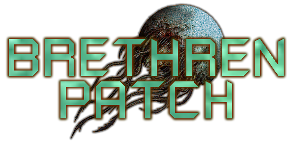

<p align="center">
  
</p>

# Brethren Patch

Fixes and options for the PC port of Dead Space 3, in the spirit of the
[Marker Patch](https://github.com/Wemino/MarkerPatch) for Dead Space 2 and
[DeadSpace2008Fixes](https://github.com/seamusduncmcgrath/DeadSpace2008Fixes)
for the first game. Neither covers Dead Space 3 and most of their patches do
not transfer, so the addresses here were found from scratch.

## What it does

**On by default**

| | |
|---|---|
| VSync no longer locks to 30 FPS | With VSync on the game runs at exactly 30 FPS whatever your monitor does. Fixed. |
| Subtitles scale with resolution | They are a fixed pixel size in the retail game and shrink as resolution goes up. |
| Checkpoint crash fix | A null pointer on checkpoint reload could kill the game. |
| No more startup logos | Straight to the menu instead of nine seconds of publisher logos. |
| No more attract video | The trailer that plays if you idle in the menu is gone. |
| Classic coop campaign | The Classic entry is exposed and gets a normal two player lobby. Both players need the patch and a Classic save. |
| Windows volume left alone | DS3 forces its mixer slider to 90% at startup. It no longer does. |

**Off by default, turn on in the INI**

| | |
|---|---|
| `MoreEnemies` | Multiplies the enemies the campaign throws at you. 200% is twice as many. Per enemy type sliders included. |
| `HighCoreCPUFix` | Only if the game is unstable on a many-core CPU. |
| `UseSDLControllerInput` | Uses SDL3 for PlayStation, Nintendo and other supported controllers. |
| `FilterInputDevices` | Hides duplicate DirectInput gamepads while keeping mouse and keyboard input. |
| `GyroAiming` | Maps a controller gyro to the camera through the game's right stick path. |

**Experimental, not finished**

| | |
|---|---|
| `HavokPhysicsFix` | Ragdolls above 30 FPS. Helps, but only about half the time. |
| `DepthOfFieldFix` | Does not work yet, see the notes below. |
| `EnemyRandomizer` | Randomises which enemy each spawn point produces. Work in progress. |
| `RawMouseInput` | Raw input for weapon aiming on foot. Hip camera, zero-G and scripted cameras are not covered yet. |

Every code patch checks a byte signature before it applies. Unsupported code is
left untouched. Enable `DebugLogging` when you need the result of those checks.

## Install

### Windows

**[Download BrethrenPatch_1_2.zip](https://github.com/RichardHafer/BrethrenPatch/releases/latest/download/BrethrenPatch_1_2.zip)**

Close the game and extract the archive into the Dead Space 3 folder, next to
`deadspace3.exe`. The installed files should look like this:

```text
Dead Space 3/
|-- winmm.dll
|-- SDL3.dll
|-- BrethrenPatch.ini
`-- plugins/
    `-- BrethrenPatch.asi
```

### Steam Deck and Proton

**[Download BrethrenPatch_1_2_Proton.zip](https://github.com/RichardHafer/BrethrenPatch/releases/latest/download/BrethrenPatch_1_2_Proton.zip)**

Switch to Desktop Mode, close the game and extract the Proton archive into the
Dead Space 3 folder. In Steam, use **Properties**, **General**, **Launch
Options** and enter:

```text
WINEDLLOVERRIDES="dinput8=n,b" %command%
```

The Proton installation must look like this:

```text
Dead Space 3/
|-- dinput8.dll
|-- dinput8Hooked.dll
|-- SDL3.dll
|-- BrethrenPatch.ini
`-- plugins/
    `-- BrethrenPatch.asi
```

Do not rename `winmm.dll` to `dinput8.dll`. The file named `dinput8.dll` in the
Proton archive is a separate bootstrap. It loads the patch and forwards the
game's DirectInput calls to `dinput8Hooked.dll`.

Remove any local `winmm.dll` from the game folder when using the Proton
package. SDL3 itself imports WinMM, so leaving the Windows ASI loader there can
cause a black screen or stop the patch from loading.

The bundled `dinput8Hooked.dll` is a 32-bit Wine DirectInput module. If it does
not work with the Proton version selected in Steam, replace it with the x86
`dinput8.dll` from that Proton prefix and rename the copy to
`dinput8Hooked.dll`. It is normally found at:

```text
steamapps/compatdata/1238060/pfx/drive_c/windows/syswow64/dinput8.dll
```

Copy the file the symbolic link points to, not the symbolic link itself. Do
not use the 64-bit copy from `system32`.

`SDL3.dll` must remain beside `deadspace3.exe`. It is a runtime dependency of
the patch even when SDL controller input is disabled in the INI.

Settings live in `BrethrenPatch.ini`, which is split into FIXES, OPTIONS and
EXPERIMENTAL so you can see at a glance what is safe to turn on.

If the game does not start afterwards, update the
[Microsoft Visual C++ Redistributable (x86)](https://aka.ms/vs/17/release/vc_redist.x86.exe).

Logging is off by default. Set `DebugLogging=1` before reproducing a problem,
then include `BrethrenPatch.log` with the bug report.

The Proton bootstrap always writes `BrethrenProtonBootstrap.log`. A successful
start reports that both `dinput8Hooked.dll` and `plugins/BrethrenPatch.asi`
were loaded. `BrethrenPatch.log` is only created when `DebugLogging=1`.

Do not run this together with the DS3 Debug Menu. It verifies the `.text` hash
and disables its own bindings when Brethren Patch changes code.

---

## How the bigger pieces work

Not required reading. This is here so the next person does not have to redo
the research.

### VSync

It is not a D3D9 presentation interval. The swap chain always reports
`IMMEDIATE` and no device reset happens when VSync is toggled, yet the entire
main loop runs at 30 Hz. The cause is the engine's frame rate lock multiplier:
the game passes 2 when VSync is on, and against a 60 Hz vblank that is your 30
FPS. The patch clamps the multiplier to 1.

### Subtitles

The game's drawing object can normalise against a virtual 1280x720 canvas or
against the real resolution, and text takes the second path. The reference
width follows the actual aspect ratio, so ultrawide displays do not stretch the
text: height stays anchored at 720 and width is derived, giving 1720x720 at
3440x1440 and exactly 1280x720 on any 16:9 mode.

### More enemies

When a level tells a spawn point to release an enemy, the patch asks the game
for that same enemy again through its own retry path. Nothing is constructed by
hand, so the extra enemies are created, placed, networked and given AI exactly
as the originals were. That is why they survive checkpoints and show up
correctly for a joining player.

The hard part is telling enemies from everything else. Props, doors, triggers,
cutscene actors and boss stage objects all come out of the same spawn code, and
duplicating those breaks scripting. The patch carries a table built from the
game's own level files: 1366 spawn points, of which 557 are confirmed enemies
and 809 are explicitly blocked. It also recognises 14 enemy families by their
code address, which covers spawn points the level data could not resolve.
Anything still unproven is left alone, so the failure mode is "fewer extra
enemies", never "a second locked door".

Fractions are kept exact across an encounter. At 150 every second authored
spawn gets one extra rather than rounding away to nothing.

In co-op the count follows the roster instead: up to `MoreEnemiesBasePlayers`
nothing changes, and every player past that adds `MoreEnemiesPerPlayerPercent`.
Only the host scales; clients follow what the host spawns.

More enemies means more ammo, and the game does not scale drops to match. 200
is a real difficulty change. 400 and up is a shooting gallery. It has been
tested to 800 without the spawn system running away, but that is for fun rather
than a balanced run.

### Do not lower enemy damage

`EnemyDamageTakenPercent` below 100 makes the game unwinnable in places, so the
patch refuses it. Dismemberment needs a single hit above a fixed threshold; it
is not a health percentage. Below 100 your shots fall under that threshold,
limbs stop coming off, and a Guardian, whose only weak points are its
tentacles, cannot be killed at all. To make the game harder, raise
`PlayerDamageTakenPercent` instead.

### Startup logos

The launch sequence is not a movie. It is a frontend state machine driven by
RWS messages, and the function that sends the company logo message arms a timer
from a single 9.0 second constant before waiting. The patch points that load at
a float of its own, so the duration becomes a setting.

### Controller input

SDL3 reads the physical controller and the patch maps its buttons, triggers and
sticks into the XInput state DS3 already understands. Rumble is passed back to
SDL. The DirectInput filter is separate and only removes duplicate gamepad
devices. It never filters the mouse or keyboard.

Gyro aiming currently feeds the right stick camera path and can be limited to
aiming with the left trigger.

### Raw mouse input

The on-foot weapon-aiming path can use accumulated Windows raw-input deltas.
This bypasses DS3's controller-style acceleration, smoothing and frame-time
multiplication without changing menus, buttons or controller input. The
setting is experimental and off by default while hip camera look, zero-G and
special scripted aiming paths are still being mapped.

### Depth of field, and why it is still broken

The blur is specified in pixels, so it gets weaker as resolution rises. The
obvious fix scales `minRadius` and `maxRadius` before the renderer consumes
them, which is what the Marker Patch does for Dead Space 2.

Measured in game with blur clearly on screen, those two values are always zero.
DS3 has five depth of field paths and the PC build uses the gaussian one, where
`minRadius` and `maxRadius` belong to the lens path and are structurally never
touched. So the current fix scales nothing, and it ships off.

Worth knowing for anyone picking this up: the main menu blur is not ScreenDof
at all. Testing depth of field in the menu proves nothing.

---

## Planned

- Depth of field, properly this time, via the gaussian path
- Entity persistence, so more bodies and limbs stay around
- Soft shadow blur
- Bloom
- Raw mouse support for zero-G and special scripted aiming cameras
- Auto resolution
- Multi-player campaign research. That work lives in `src/coop/` and is not
  built into the release.

## Building

Visual Studio 2022 with the x86 toolchain, then `build.bat`. Adjust the
`vcvars32.bat` path in the script if your install differs. safetyhook needs
`std::expected`, hence `/std:c++latest`. The SDL3 x86 headers, import library
and runtime are included in `include/SDL3`, `lib` and `bin`.

Addresses are specific to the tested Steam build. Signatures are matched at
runtime so an unsupported build fails safely and reports what it could not
find.

## Credits

- [safetyhook](https://github.com/cursey/safetyhook) for hooking
- [SDL3](https://www.libsdl.org/) for controller and sensor input
- [mINI](https://github.com/metayeti/mINI) for INI handling
- [Ultimate ASI Loader](https://github.com/ThirteenAG/Ultimate-ASI-Loader), shipped as winmm.dll

## Licence

MIT, see `LICENSE`. Not affiliated with EA or Visceral Games.
